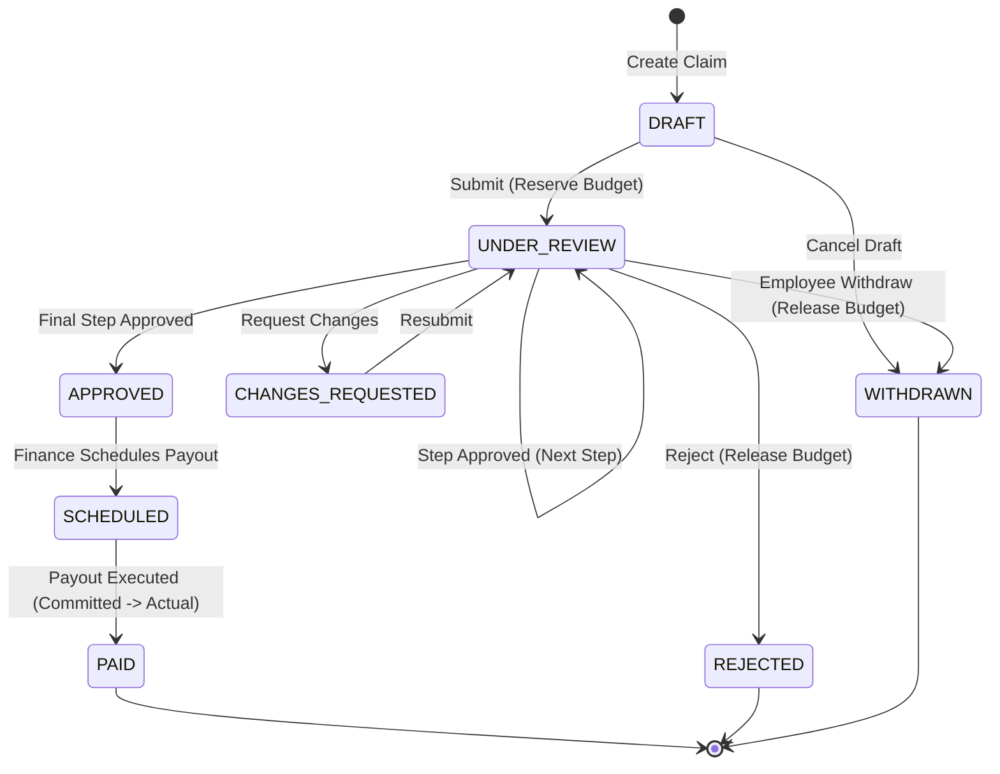

# SpendWise — Architecture & Technical Specifications

This document outlines the architectural blueprints, state machine models, transactional budget algorithms, and security boundaries implemented across **SpendWise**.

---

## 1. System Architecture Overview

SpendWise is designed with a layered service-oriented architecture:

```
┌────────────────────────────────────────────────────────┐
│             React 18 Single Page Application           │
│   (Context Providers, Role-Guarded Routes, Tailwind)   │
└───────────────────────────┬────────────────────────────┘
                            │ HTTP / REST (/api/v1)
                            ▼
┌────────────────────────────────────────────────────────┐
│                   Express.js Server                    │
│   ┌────────────────────────────────────────────────┐   │
│   │ Middleware Layer:                              │   │
│   │ • Auth & Token Extraction (Cookie / Bearer)    │   │
│   │ • Role-Based Access Control (RBAC)             │   │
│   │ • Zod Schema Validation                        │   │
│   │ • Idempotency Key Processor                    │   │
│   │ • Rate Limiting & Multer Safe Uploads          │   │
│   └────────────────────────┬───────────────────────┘   │
│                            │                           │
│   ┌────────────────────────▼───────────────────────┐   │
│   │ Service & Business Logic Layer:                │   │
│   │ • Approval State Machine & Policy Engine       │   │
│   │ • Transaction-Safe Budget Accounting           │   │
│   │ • Idempotent Reimbursement Engine              │   │
│   │ • Immutable Audit & Notification Dispatcher    │   │
│   └────────────────────────┬───────────────────────┘   │
└────────────────────────────┼───────────────────────────┘
                             │
                             ▼
┌────────────────────────────────────────────────────────┐
│            MongoDB Replica Set (WiredTiger)            │
│   • Multi-Document ACID Transactions (withSession)     │
│   • Atomic Write Conflict & Transient Retry Handler    │
│   • 13 Normalized Collections                          │
└────────────────────────────────────────────────────────┘
```

---

## 2. Expense Claim State Machine

The expense claim lifecycle follows a deterministic finite state machine with strict transition guards:



### State Transition Invariants:
1. **DRAFT $\to$ UNDER_REVIEW**:
   - Validation checks: category exists, receipt attached if required, amount > 0.
   - Dynamic policy matching assigns approvers.
   - Budget reservation created atomically.
2. **UNDER_REVIEW $\to$ UNDER_REVIEW / APPROVED**:
   - Current step approver must match the logged-in user (or authorized delegate).
   - Self-approval check: claim submitter $\neq$ approver (unless `allowSelfApproval` is enabled).
   - If more steps remain: workflow advances to `currentStep + 1`.
   - If final step: claim status transitions to `APPROVED`, workflow status to `APPROVED`.
3. **UNDER_REVIEW $\to$ CHANGES_REQUESTED**:
   - Comments are mandatory.
   - Submitter can edit claim details and upload additional receipts before resubmitting.
4. **UNDER_REVIEW $\to$ REJECTED / WITHDRAWN**:
   - Budget reservation is atomically deleted.
   - Budget `committedAmount` is decreased by claim amount.
5. **APPROVED $\to$ SCHEDULED $\to$ PAID**:
   - Only `finance` or `admin` roles can transition these states.
   - At payment execution, `committedAmount` decreases and `spentAmount` increases atomically.

---

## 3. Transaction-Safe Budget Accounting Engine

### Mathematical Formula:
$$\text{Available Budget} = \text{Allocated} - (\text{Committed} + \text{Actual})$$

### State Transitions & Accounting Balance:

| Event | `allocatedAmount` | `committedAmount` | `spentAmount` | Net Available Change |
| :--- | :---: | :---: | :---: | :---: |
| **Claim Submitted** | — | $+\Delta$ | — | $-\Delta$ |
| **Claim Rejected / Withdrawn** | — | $-\Delta$ | — | $+\Delta$ |
| **Claim Reimbursed (Paid)** | — | $-\Delta$ | $+\Delta$ | $0$ (Zero Double Counting) |
| **Budget Top-Up** | $+\text{Amount}$ | — | — | $+\text{Amount}$ |

### Concurrency and ACID Guarantees:
1. Every budget change is wrapped in a MongoDB transaction using `withTransaction(async (session) => { ... })`.
2. Atomic check query:
   ```javascript
   const budget = await Budget.findOneAndUpdate(
     {
       _id: budgetId,
       status: 'active',
       $expr: {
         $gte: [
           { $subtract: ['$allocatedAmount', { $add: ['$committedAmount', '$spentAmount'] }] },
           claimAmount
         ]
       }
     },
     { $inc: { committedAmount: claimAmount } },
     { session, new: true }
   );
   ```
3. If concurrent requests target the same budget, WiredTiger detects conflicting locks and throws a `WriteConflict` (code 112 / `TransientTransactionError`). The custom Express error handler intercepts this and returns HTTP 409 Conflict with retry instructions.

---

## 4. Idempotent Financial Reimbursement

To prevent financial loss due to network dropouts or duplicate double-clicks during payout execution:

```
Client Request
      │ (POST /reimbursements/execute)
      │ Header: Idempotency-Key = "d8e3-..."
      ▼
┌──────────────────────────────────────────────┐
│         Idempotency Middleware               │
├──────────────────────────────────────────────┤
│ 1. Search IdempotencyKey collection          │
│    • If found & COMPLETED: Return cached res │
│    • If found & PENDING: Return 409 Conflict │
│ 2. Create pending IdempotencyKey record      │
│ 3. Proceed to Reimbursement Controller       │
└──────────────────────┬───────────────────────┘
                       │
                       ▼
┌──────────────────────────────────────────────┐
│       Reimbursement Service (ACID)           │
├──────────────────────────────────────────────┤
│ 1. Verify Claim is APPROVED or SCHEDULED     │
│ 2. Create Reimbursement document             │
│ 3. Update Claim status to PAID               │
│ 4. Shift Budget: Committed -> Actual         │
│ 5. Mark IdempotencyKey COMPLETED with body   │
│ 6. Commit Transaction                        │
└──────────────────────────────────────────────┘
```

---

## 5. Append-Only Audit Logging

All system events are logged to the `AuditLog` collection with the following guarantees:
- **Immutable**: No `UPDATE` or `DELETE` endpoints exist for audit logs.
- **Detailed Payload**: Includes `actorId`, `action`, `resourceType`, `resourceId`, `ipAddress`, `userAgent`, and a structured `diff` object (`before` and `after` snapshots).
- **Searchable**: Indexed by `resourceType`, `resourceId`, `actorId`, and `createdAt` for audit reporting and visualization.

---

## 6. Security Boundaries

- **Authentication**: JWT with cryptographic signature stored in `HttpOnly`, `SameSite=Lax` cookies.
- **CSRF & Token Extraction**: Fallback support for `Authorization: Bearer <token>` in automated testing and external API consumers.
- **Multi-Tenant / Employee Isolation**: Database queries for non-administrative roles are strictly scoped:
  ```javascript
  if (req.user.role === 'employee') {
    filter.employeeId = req.user._id;
  }
  ```
- **File Upload Security**: Receipts are validated by MIME type (only `image/jpeg`, `image/png`, `image/webp`, and `application/pdf`) and capped at 5MB per file. File contents are served via authenticated streaming routes.
